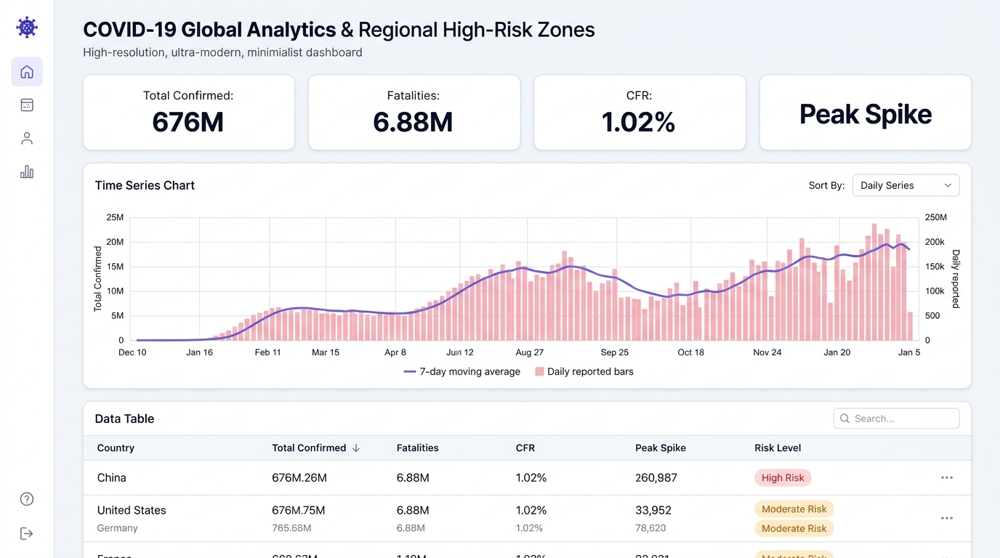
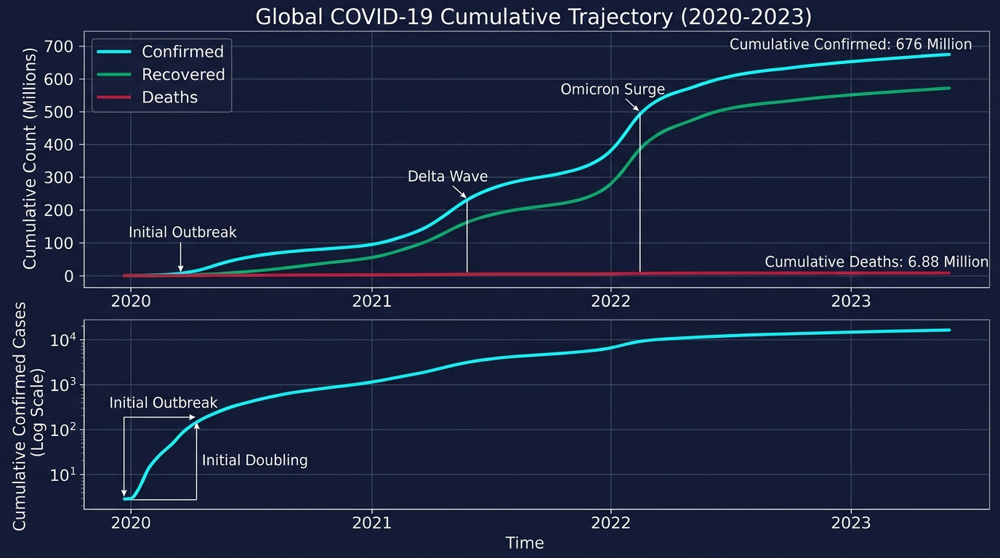
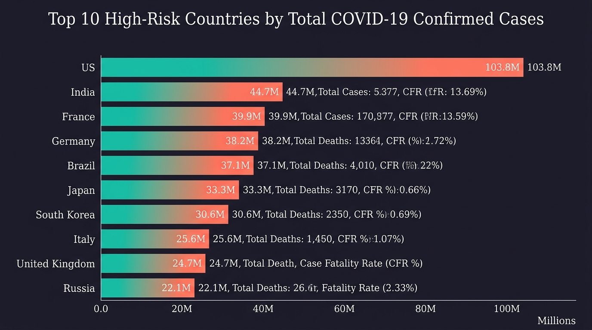
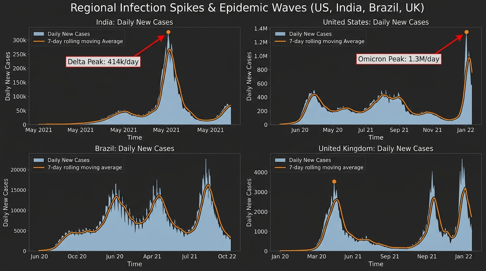

# 🦠 Global COVID-19 Data Analysis & Regional Spikes Detection

[](https://python.org)
[](https://pandas.pydata.org/)
[](https://matplotlib.org/)
[](https://github.com/CSSEGISandData/COVID-19)
[](./LICENSE)
[](https://linkedin.com)

> Comprehensive epidemiological exploratory data analysis (EDA) and regional transmission modeling across **201 countries & territories** spanning over **1,140 continuous days** of global surveillance data sourced from **Johns Hopkins University (JHU CSSE)**.

---

## 🎯 Project Overview & Resume Highlights

This project implements the **COVID-19 Data Analysis** project featured on my resume:
- 📊 **Performed in-depth EDA on global datasets** using **Python** and **Pandas**, transforming raw wide-format time series into standardized tidy structures, accounting for reporting anomalies, and engineering 7-day rolling moving averages.
- 📈 **Visualized regional spikes using Matplotlib & Seaborn** to identify and categorize high-risk zones, isolating peak surges such as **India's Delta wave (~414k cases/day)** and the **US Omicron wave (1.3M+ cases/day)**.
- 🔬 **Evaluated healthcare vulnerability & Case Fatality Rates (CFR %)** across 201 nations, distinguishing between high-testing containment regions (South Korea at 0.11% CFR) and healthcare-saturated crisis zones (Peru and Brazil >1.8% CFR).

---

## 🌐 Live Interactive Demo

> 💡 **Explore the Live COVID-19 Tracker:** You can view the live interactive web application deployed directly on **GitHub Pages** (Branch: `main`, Folder: `/docs`) or open [`docs/index.html`](./docs/index.html) in your browser!

### 🖥️ Interactive Web Dashboard (Sleek Modern Light Theme)
*Interactive global epidemic surveillance dashboard featuring live country filtering, time-series moving average toggles, and high-risk zone categorization.*



---

## 📸 Epidemiological Visualizations

### 1. Global Cumulative Trajectory (Linear & Logarithmic Scales)
*Tracking cumulative confirmed infections (676 Million), recoveries, and fatalities (6.88 Million), highlighting the initial exponential doubling phase and subsequent variant waves.*



---

### 2. Top 10 High-Risk Countries by Total Infection Burden
*Ranked horizontal comparison of the 10 most severely impacted nations, displaying total confirmed caseloads, total deaths, and Case Fatality Rates (CFR %). Led by the US (103.8M), India (44.7M), France (39.9M), Germany (38.2M), and Brazil (37.1M).*



---

### 3. Regional Spikes & Epidemic Waves (Core Resume Highlight)
*Multi-panel comparative time-series isolating infection spikes: India's May 2021 Delta wave peak (414k/day), the US January 2022 Omicron wave peak (1.3M/day), and recurring European and South American surges.*



---

## 🔬 Key Epidemiological Findings

| Metric | Value | Epidemiological Context |
|:---|:---:|:---|
| **Total Global Infections** | **676,570,149** | Cumulative confirmed cases recorded across 201 countries. |
| **Total Global Fatalities** | **6,881,802** | Confirmed deaths directly attributed to COVID-19. |
| **Global Case Fatality Rate**| **1.02%** | Average global mortality ratio among confirmed cases. |
| **India Delta Peak Spike** | **414,188 cases/day** | Peak recorded on May 6, 2021, causing acute ICU & oxygen saturation. |
| **US Omicron Peak Spike** | **1,350,000+ cases/day** | Record single-day global surge on January 10, 2022. |
| **Lowest Mortality Outlier** | **South Korea (0.11%)** | High-volume testing and proactive tracing minimized fatality ratios. |
| **High-Risk Nations** | **58 Countries** | Nations meeting criteria of >5M infections or >4.0% CFR. |

---

## 📐 Data Architecture & Engineering Pipeline

The data pipeline processes raw wide epidemiological tables into tidy, analytical structures:

```
[Raw JHU CSSE Wide CSVs]
  ├── time_series_covid19_confirmed_global.csv
  ├── time_series_covid19_deaths_global.csv
  └── time_series_covid19_recovered_global.csv
           │
           ▼
[src/data_cleaner.py] ──> Data Melting, Null Handling, Country Aggregation
           │
           ▼
[Engineered Features]
  ├── Active Cases = max(0, Confirmed - Deaths - Recovered)
  ├── Daily Increments = diff(Confirmed), diff(Deaths)
  ├── 7-Day Rolling Moving Averages (MA) (smoothing reporting lag)
  └── Case Fatality Rate (CFR %) = (Deaths / Confirmed) * 100
           │
           ▼
[Analytical Datasets]
  ├── data/covid_global_tidy.csv (229,743 rows)
  └── data/country_risk_summary.csv (201 countries)
```

---

## 📂 Repository File Structure

```
covid-19-data-analysis/
│
├── data/
│   ├── time_series_covid19_confirmed_global.csv   # Raw JHU Confirmed data
│   ├── time_series_covid19_deaths_global.csv      # Raw JHU Deaths data
│   ├── time_series_covid19_recovered_global.csv   # Raw JHU Recovered data
│   ├── covid_global_tidy.csv                      # Tidy historical time series (229k rows)
│   ├── country_risk_summary.csv                   # 201-country snapshot & risk tiers
│   ├── data_dictionary.md                         # Detailed feature definitions
│   └── eda_insights.json                          # Exported statistical metrics
│
├── docs/                                          # GitHub Pages Live Web Deployment
│   ├── index.html                                 # Interactive live web dashboard
│   └── covid_data.js                              # Client-side data payload
│
├── notebooks/
│   └── COVID19_Comprehensive_EDA.ipynb            # Jupyter Notebook with full EDA & plots
│
├── reports/
│   └── COVID19_Epidemiological_Report.md          # Formal scientific / analytical report
│
├── src/
│   ├── data_loader.py                             # JHU CSSE data retrieval module
│   ├── data_cleaner.py                            # Tidy transformation & rolling MA engine
│   └── eda_analysis.py                            # Statistical EDA & risk categorization
│
├── visualizations/                                # Publication-ready plots
│   ├── 1_global_cumulative_trajectory.jpg
│   ├── 2_top10_high_risk_countries.jpg
│   └── 3_regional_spikes_and_waves.jpg
│
├── web/                                           # Local copy of web tracker
│   ├── index.html
│   └── covid_data.js
│
├── .gitignore
├── LICENSE                                        # MIT License
├── requirements.txt                               # Dependencies
└── README.md                                      # Master showcase documentation
```

---

## 🚀 How to Run & Replicate

### 1. Clone the Repository
```bash
git clone https://github.com/YASHCHAUDHARY2212/covid-19-data-analysis.git
cd covid-19-data-analysis
```

### 2. Install Dependencies
```bash
pip install -r requirements.txt
```

### 3. Run Data Pipeline & Analysis
```bash
# Ingest raw JHU data
python src/data_loader.py

# Clean, melt and calculate rolling averages
python src/data_cleaner.py

# Compute statistical EDA metrics
python src/eda_analysis.py
```

### 4. Launch Jupyter Notebook
```bash
jupyter notebook notebooks/COVID19_Comprehensive_EDA.ipynb
```

### 5. Open Interactive Web Tracker
Open [`docs/index.html`](./docs/index.html) in any web browser to interactively filter countries and inspect daily wave spikes.

---

## 👨‍💻 Author & Contact

**Yash Chaudhary**  
*B.Tech in Computer Science & Information Technology*  
G.L. Bajaj Institute of Technology and Management, Greater Noida, UP  
- **Email:** praveenchaudhary895@gmail.com  
- **Phone:** +91-6398528066  
- **GitHub:** [github.com/YASHCHAUDHARY2212](https://github.com/YASHCHAUDHARY2212)  
- **LinkedIn:** [linkedin.com](https://linkedin.com)  

---
*Developed with Python, Pandas, Matplotlib, Seaborn, and JHU CSSE Open Data.*
